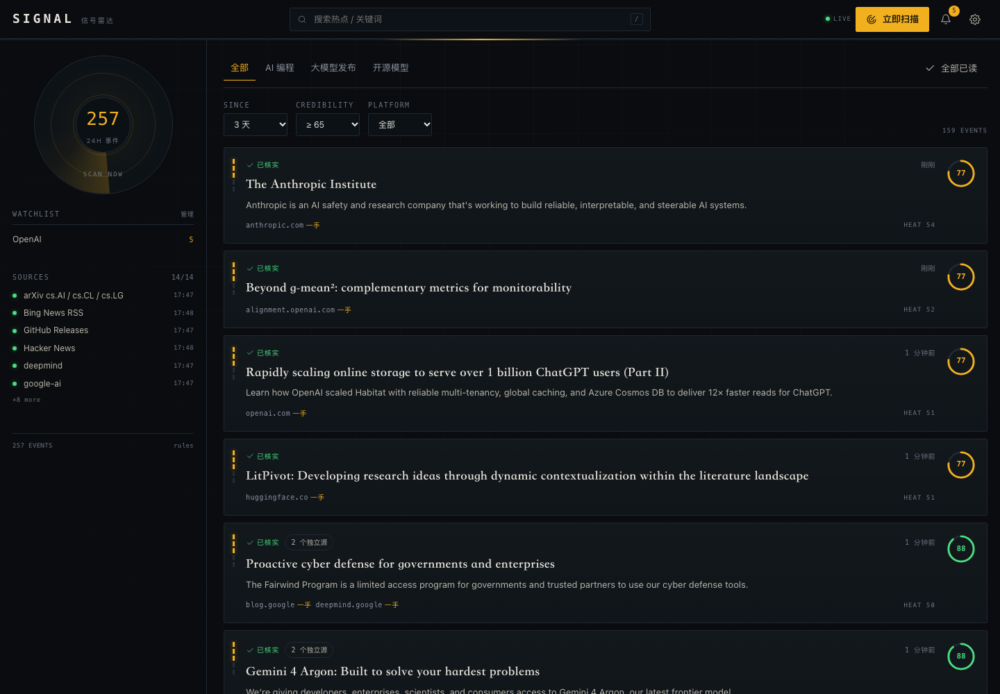
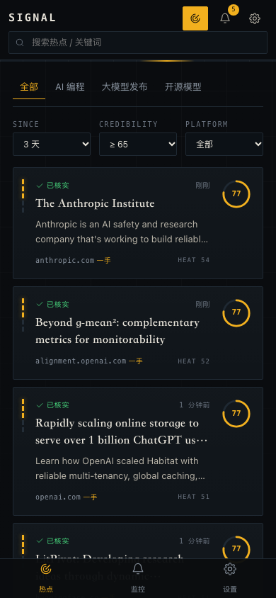
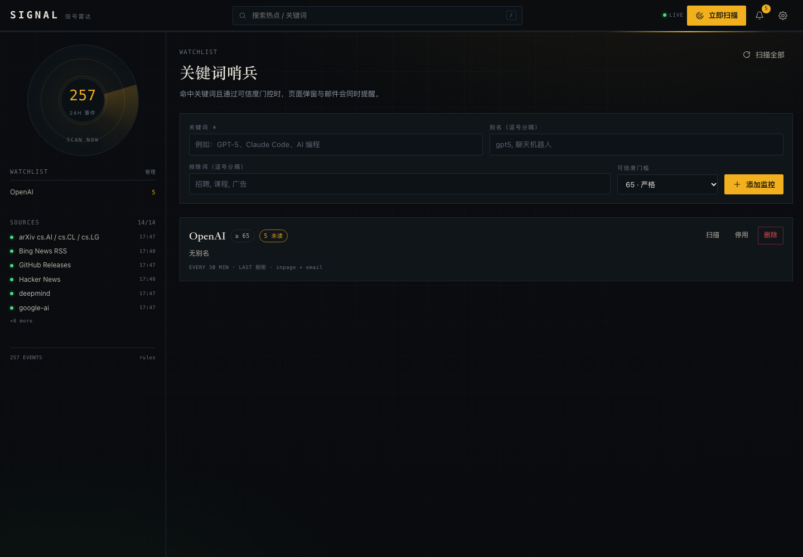
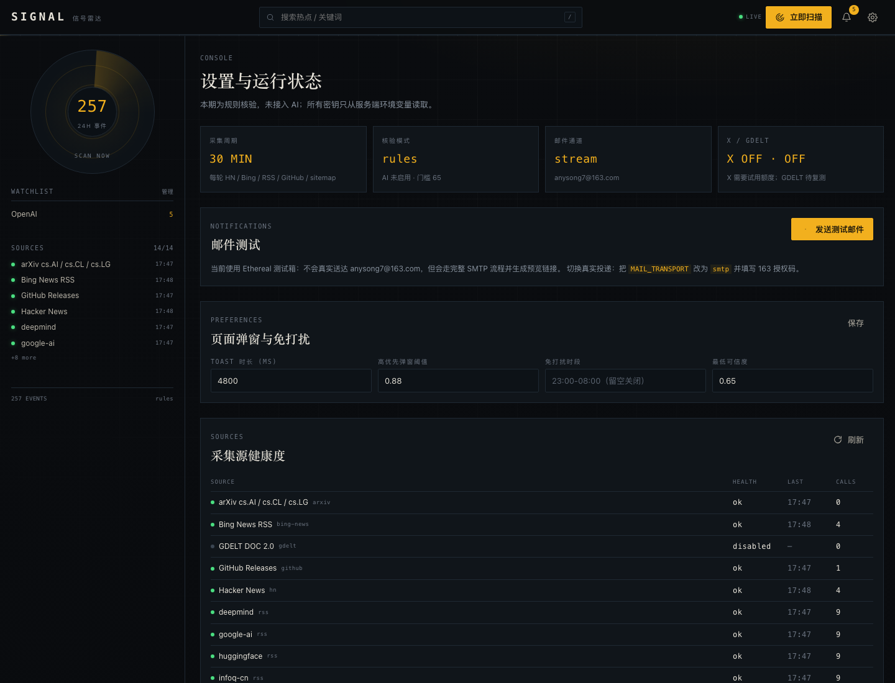

# SIGNAL · 信号雷达

> 本地优先的 AI 热点雷达：监控关键词、每 30 分钟汇总热点、页面弹窗 + 邮件提醒。
> 当前状态：**网页版与 Agent Skill 已完成**，`npm test` 39 项通过；邮件默认 Ethereal 预览，可切 163。

## 验收截图

| 桌面热点流 | 移动端 390px |
|---|---|
|  |  |

| 关键词监控 | 设置与源健康 |
|---|---|
|  |  |

事件详情（证据链 + 评分拆解）：[desktop-event.png](docs/screenshots/desktop-event.png)

## 它能做什么

- **关键词监控**：添加「GPT-5.2」「AI 编程」等词，命中后推送；
- **范围热点**：内置「AI 编程 / 大模型发布 / 开源模型」，每 30 分钟自动更新；
- **多源采集**：Hacker News、Bing News RSS、官方博客 RSS、sitemap 爬虫、中文媒体、arXiv、GitHub Releases；X 适配器默认关闭；
- **规则核验**：一手源 + 独立域名印证 + 传闻词 + 高仿检测，未证实内容只进观察区；
- **通知**：页面 Toast / 高优先弹窗 + 邮件（Ethereal 测试箱，可切 163）；
- **Agent Skill**：网页验收后提供 `SKILL.md` + CLI，供其他 AI 调用。

## 技术栈

| 层 | 选型 |
|---|---|
| 后端 | Node.js 24 + Express 5.3 + `node:sqlite` |
| 前端 | Vue 2.7.16 + vue-router 3.6.5 + Vite 7.3.7 |
| 采集 | `fetch` + fast-xml-parser + cheerio + robots-parser |
| 邮件 | nodemailer 10（Ethereal / SMTP） |
| 测试 | `node --test` |

> 为什么锁 Vite 7：`@vitejs/plugin-vue2` 的 peer 上限是 Vite 7，Vite 8 不兼容。详见 `docs/08-decisions.md`。

## 3 分钟验收

1. 打开 `http://127.0.0.1:8787`，应看到热点流（演示数据来自真实 HN / RSS / GitHub 采集）；
2. 进入「监控」，添加关键词 `Anthropic`（别名 `claude`），列表会立即回填最多 5 条命中；
3. 点右上「立即扫描」，观察扫描进度与新增卡片；有命中时会弹出 Toast；
4. 进入「设置」→「发送测试邮件」，点击预览链接查看邮件模板；
5. 终端执行：
   ```bash
   node .claude/skills/hotspot-radar/scripts/radar.mjs hotspots --since 24h --json
   ```
   应返回 `verifyMode: "rules"` 与带 `credibility`、`sources` 的事件数组。

> 当前工作区的 `data/radar.db` 是本地演示数据（已被 `.gitignore` 忽略）；删除后首次启动会自动采集。

## 快速开始

```bash
# 1. 安装
npm install

# 2. 配置
cp .env.example .env
# 至少确认 MAIL_TO、SCAN_INTERVAL_SEC；可选填 GITHUB_TOKEN / TWITTERAPI_KEY

# 3. 开发（API 8787 + 前端 5173）
npm run dev

# 或生产模式（单端口 8787）
npm run build
npm start
```

打开 `http://127.0.0.1:8787`（开发模式为 `http://127.0.0.1:5173`）。

## 首次使用

1. 右上角「立即扫描」，等待首轮采集（约 10–30 秒）；
2. 左栏「关键词」→ 添加 `GPT-5`（别名 `gpt5`）；
3. 热点页按「AI 编程」筛选，点击卡片看证据链；
4. 设置页点「发送测试邮件」，会返回 Ethereal 预览链接；
5. 想接真实邮箱：把 `MAIL_TRANSPORT` 改为 `smtp`，填 163 的 SMTP 授权码（不是登录密码）。

## 目录

```
server/    Express API、采集器、规则核验、调度、通知
client/    Vue 2 前端
docs/      需求、架构、数据源、核验、API、设计、测试、ADR
tests/     单元与集成测试
.claude/skills/hotspot-radar/   P6 产出的 Agent Skill
```

## 常用命令

```bash
npm run dev          # 同时起后端与前端
npm run dev:server   # 仅后端（--watch）
npm run dev:client   # 仅前端
npm test             # node --test
npm run scan         # CLI 扫描一次
```

## 配置

完整清单见 `docs/04-api-data.md` §7 与 `.env.example`。重点：

| 变量 | 默认 | 说明 |
|---|---|---|
| `SCAN_INTERVAL_SEC` | `1800` | 全局 30 分钟 |
| `X_ENABLED` | `false` | 开启需 `TWITTERAPI_KEY`（付费，$1 试用） |
| `GDELT_ENABLED` | `false` | 待复测 |
| `VERIFY_MODE` | `rules` | 本期无 AI |
| `MAIL_TRANSPORT` | `ethereal` | 改为 `smtp` 可真实投递 |
| `MAIL_TO` | `anysong7@163.com` | 预置收件人 |
| `HOST` | `127.0.0.1` | 公网部署必须设 `ACCESS_TOKEN` |

> 若 Ethereal 的 SMTP 被网络拦截，会自动降级为本地 HTML 预览（`data/mail-preview/`），告警不会丢失。

## 合规与边界

- 只使用公开 RSS/API，遵守 `robots.txt`；
- **不抓取搜索引擎 HTML 结果页**（Bing/Google robots 禁止，DuckDuckGo 实测验证码）；
- Google News RSS 因 robots 未允许而关闭；
- Bing News RSS 按其声明仅用于个人、非商业的 RSS 阅读；
- 只存标题、短摘要、链接与公开互动数，不存正文与图片；
- 本期为**规则核验**，不是 AI 判定；无法保证识别所有虚假信息。

## 文档索引

| 文档 | 内容 |
|---|---|
| [00-requirements.md](docs/00-requirements.md) | 需求与验收定义 |
| [01-architecture.md](docs/01-architecture.md) | 架构、版本锁定、实现约束 |
| [02-data-sources.md](docs/02-data-sources.md) | 数据源、限流、X 接入 |
| [03-verification.md](docs/03-verification.md) | 规则核验与评分 |
| [04-api-data.md](docs/04-api-data.md) | API、SSE、数据库、配置 |
| [05-ui-design.md](docs/05-ui-design.md) | 视觉与交互规范 |
| [06-test-acceptance.md](docs/06-test-acceptance.md) | 测试与验收清单 |
| [07-agent-skill.md](docs/07-agent-skill.md) | Skill 设计 |
| [08-decisions.md](docs/08-decisions.md) | ADR |
